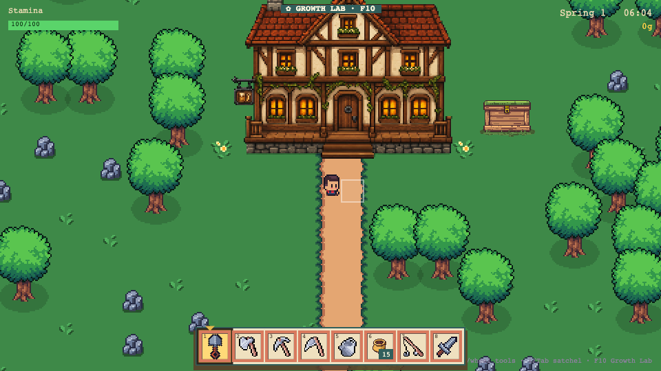
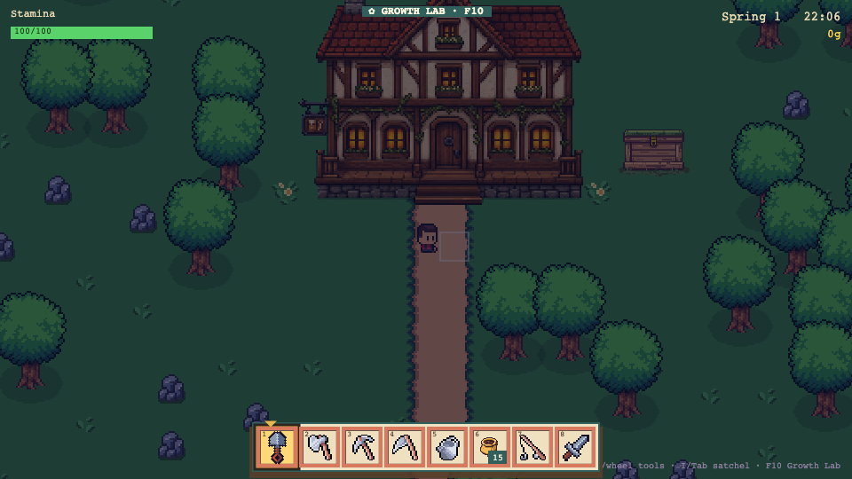
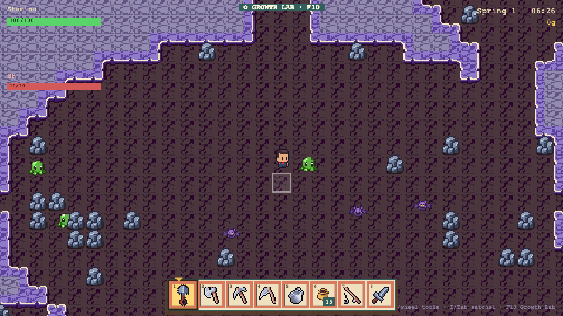

# Shopkeeper's Legacy

A browser-based 2D top-down pixel-art game: **Stardew Valley** farming crossed with
**Moonlighter** shop-management and dungeons. You inherit a rundown plot from your grandpa,
clear the overgrown land, farm it, and grow a shop empire — tavern/inn, potions, blacksmith —
with dungeon-diving in the mines. Built with Phaser 3 + TypeScript + Vite.

> **Heads up on art:** this repo ships the game **code**, not the art. The visuals come from
> third-party asset packs whose licenses don't allow redistribution, so you download them once
> yourself (free) and drop them in. See **[Getting the art assets](#getting-the-art-assets)** below.
> The game runs with placeholder shapes until you add them.

## Screenshots

| | |
|---|---|
|  |  |
| *Your inherited farm and home, by day.* | *The day/night cycle — 10 PM on the farm.* |



*Combat in the mines — the Moonlighter side.*

## What works today

Well past a prototype — it's genuinely playable:

- Large 100×100 maps with a multi-scene world (Farm, Forest, Town, Beach, Mountain, Mines, Home)
- Full farming loop: till → plant → water → grow → harvest
- Tools, stamina, hotbar; clear land by chopping/mining/scything
- Inventory and chests, day/night cycle and sleep, building placement
- NPCs with dialogue, fishing (with a reel minigame), a gold/shipping economy, crafting
- A Moonlighter-style combat dungeon in the Mines
- 41+ Playwright gameplay tests

Still on the roadmap: more crafting, a relationship system, deeper dungeons, and music. See
`docs/ROADMAP.md`.

## Quick start

Requires **Node.js 18+**.

```bash
npm install
npm run dev        # play at http://localhost:5273
```

Then follow **[Getting the art assets](#getting-the-art-assets)** for the real visuals.

Other commands:

```bash
npm run build      # type-check + production build
npm run preview    # preview the production build (port 4173)
npm run typecheck  # type-check only
npm test           # run the Playwright gameplay specs
```

One-time, before running tests:

```bash
npx playwright install chromium
```

### Controls

| Key | Action |
|---|---|
| **WASD** | Move |
| **1–6 / mouse-wheel / click** | Select tool from the hotbar |
| **Space or left-click** (hold) | Use the selected tool |
| **E** | Interact — talk / open chest / harvest / sleep |
| **I or Tab** | Open the bag |

Walk east to reach Town; enter the house door for the bed. Trees take 3 chops, rocks 2.

## Getting the art assets

The art is **not** in this repo because the packs it uses can't be legally redistributed. Getting
them is a one-time, mostly-free step:

1. **Cute Fantasy RPG** (terrain, trees, rocks, weeds) by Kenmi —
   https://kenmi-art.itch.io/cute-fantasy-rpg
   The free version is fine for playing locally (non-commercial). Buy the premium license before any
   commercial use.
2. **Sunnyside World** (player character + tool/crop/resource icons) by Daniel Diggle —
   https://danieldiggle.itch.io/sunnyside
3. **Farming tools icons** by PixelLate (base tool icons) —
   https://pixel-late.itch.io/farming-tools

Download each pack, then place the sprites under `public/assets/` following the layout the game
expects (`characters/`, `objects/`, `tilesets/`, `ui/`). The full mapping of which sprite goes
where is in `CREDITS.md` and the asset config under `src/config/`.

Building/interior art and some icons were generated with **PixelLab** (https://pixellab.ai); those
are the project's own and don't need downloading.

If you'd rather just try the game, it boots with simple placeholder graphics and no downloads.

## How this was built

Shopkeeper's Legacy was built as an experiment in "frontloading" — writing a tight spec, art
bible, and build order up front, then letting an AI coding agent build it milestone by milestone
with Playwright verifying each step. The methodology kit lives in the repo:

| File | Purpose |
|---|---|
| `docs/GAME_SPEC.md` | The full spec: definition of done, tech contract, controls, worlds, systems, build order. |
| `docs/ART_BIBLE.md` | Canonical art style — palette, tile size, perspective — so generated art stays cohesive. |
| `docs/ROADMAP.md` | What's done and what's next. |
| `AGENTS.md` / `CLAUDE.md` | Build rules an AI agent auto-reads: stack, hard rules, test protocol. |

## License

Code is under the MIT License — see `LICENSE`.

**Art is not covered by that license.** The third-party asset packs listed above are each governed
by their own licenses (see `CREDITS.md`). You must obtain them from their creators under their
terms; they are not redistributed here.
