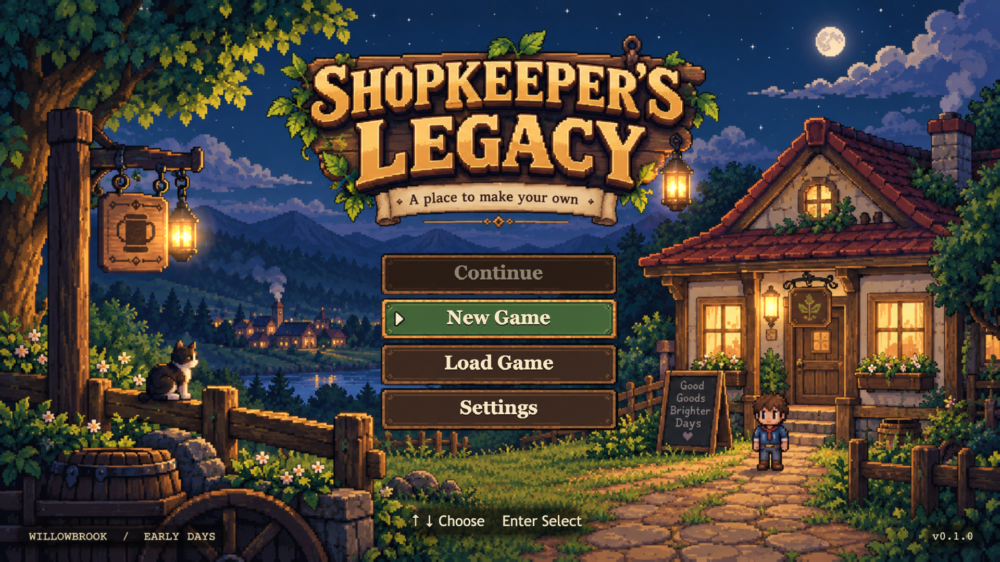
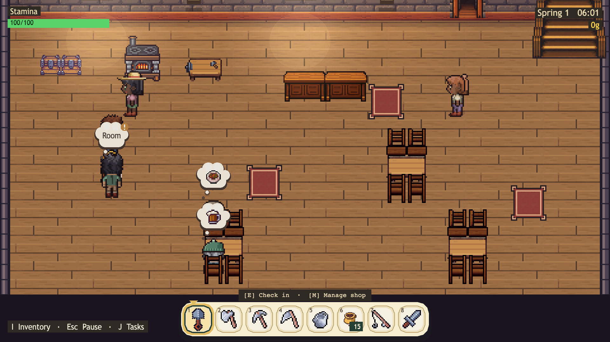
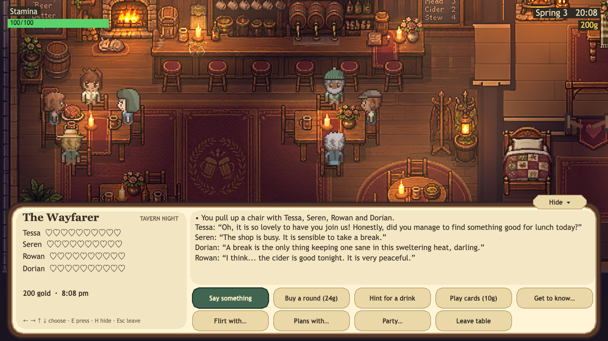
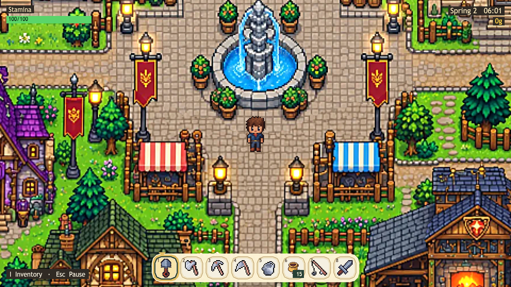
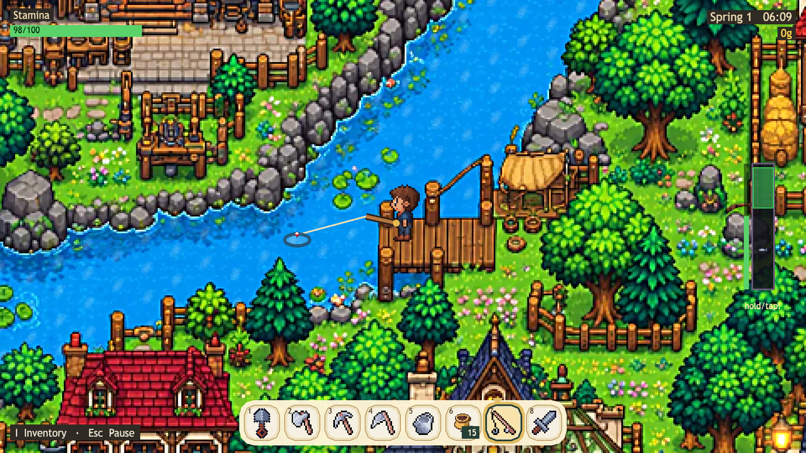
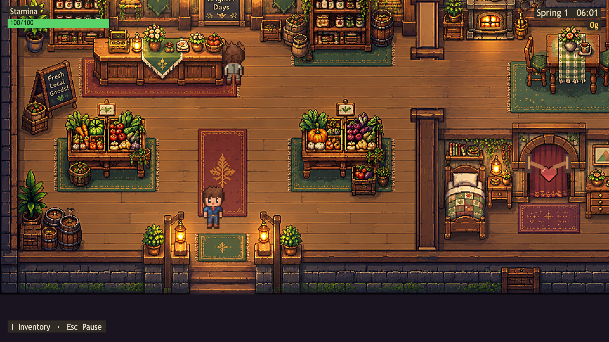
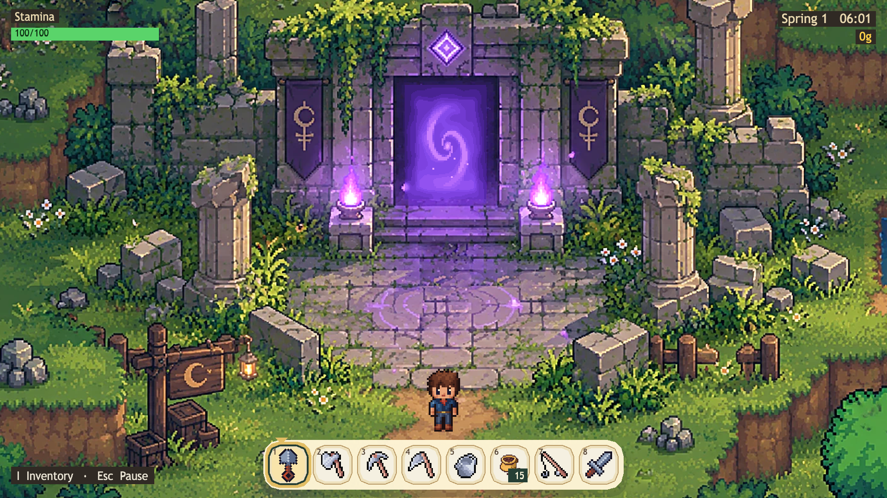
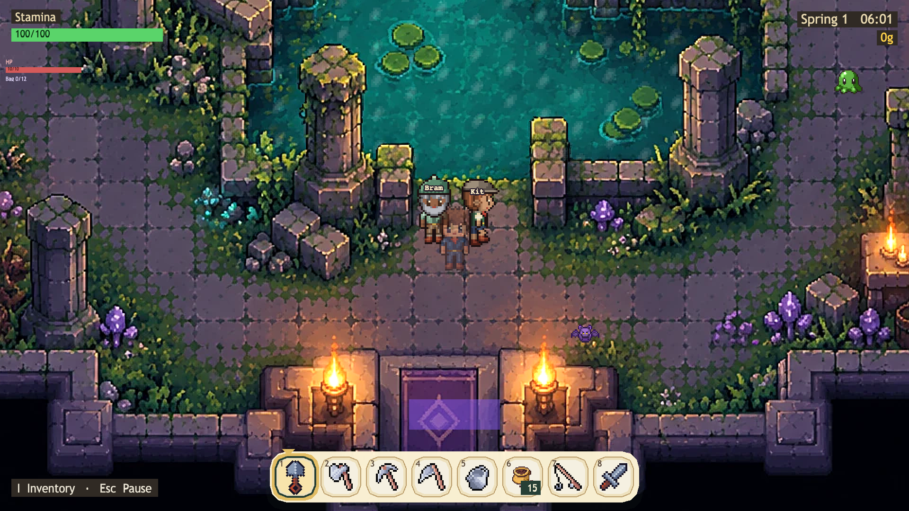
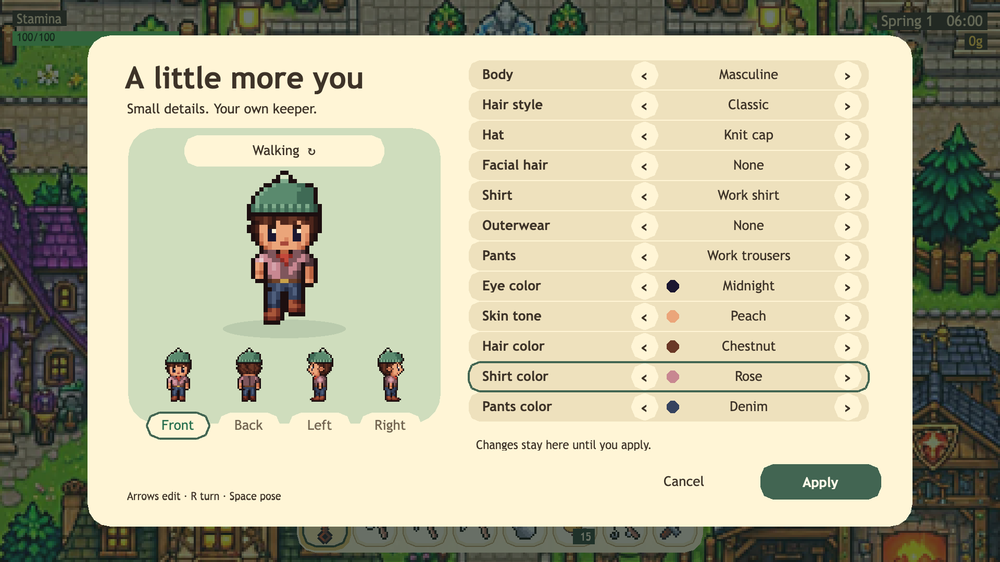

# Shopkeeper's Legacy

A browser-based 2D top-down pixel-art life sim. You inherit Grandpa's run-down shop in
Willowbrook. By day you farm, gather, fish, cook and run the tavern and inn. In the evening you
sit with the townsfolk by the fire. In the morning you head north through the old gates to delve
a portal dungeon with friends at your side. Built with Phaser 3, TypeScript and Vite.



## Screenshots

| | |
|---|---|
|  |  |
| *Run the shop: check guests in, cook, serve and sweep.* | *Sit with the town at the Wayfarer. Each resident keeps their own voice.* |
|  |  |
| *Willowbrook, hand-painted and walkable.* | *Hold to charge a cast, then reel the fish in.* |
|  |  |
| *Eleven painted shops and halls to visit.* | *The Gate Plaza opens north of the farm on day 5.* |
|  |  |
| *Bring residents into the portal dungeon as a party.* | *Dress your keeper in the wardrobe.* |

## What works today

The first week (days 1–7) plays from start to finish:

- **A living town.** Residents keep schedules, remember your gifts, mention each other, and send
  letters. Friendship, romance stages, bonds between residents and a small justice system are in.
- **The shop.** Restore Grandpa's shop, then run it as a tavern and inn: check guests in, cook
  stew, pour ale, book rooms, break up bar fights and sweep up after them.
- **Farming and gathering.** Till, plant, water and harvest six crops. Chop, mine, scythe, forage
  and fish (six fish, with a charged cast and a reel minigame). Cook eight recipes.
- **A world to walk.** Farm, painted Town with eleven painted interiors, the Wayfarer tavern, your
  bedroom, Forest, Beach, Mountain and Mines.
- **Adventure.** On day 5 the north trail opens to the Gate Plaza. Its portal leads to a painted
  dungeon with floors of rooms, a boss and a small bag. Recruit residents as party companions;
  they follow you and fight. Dungeon loot upgrades the forge and alchemy house.
- **Your keeper.** A wardrobe (in the pause menu) for body, hair, hat, facial hair, clothes and
  colours.
- **Saves** in the browser, with migrations so old saves keep working.
- **Tests.** 99 Playwright spec files (about 490 gameplay tests).

Next on the roadmap: full seasons and festivals, events between residents, more gates, marriage,
sound and music. See [`docs/VISION.md`](docs/VISION.md).

## Quick start

You need **Node.js 18+** and the art packs listed in [Art assets](#art-assets). The game does not
start without them: every texture must load. If a file is missing, the screen stays blank and the
browser console names each missing file.

```bash
npm install
npm run dev        # play at http://localhost:5273
```

Other commands:

```bash
npm run build      # type-check + production build
npm run preview    # preview the production build (port 4173)
npm run typecheck  # type-check only
npm test           # run the Playwright gameplay specs
```

Before you run tests the first time:

```bash
npx playwright install chromium
```

### Controls

| Key | Action |
|---|---|
| **WASD** or **arrow keys** | Move |
| **1–8**, mouse wheel or click | Pick a hotbar slot: hoe, axe, pickaxe, scythe, watering can, seeds, rod, sword |
| **Space** (hold) | Use the tool. Hold the rod to charge a longer cast. In combat, swing the sword. |
| **Shift** | Dodge (dungeon and mines) |
| **E** | Talk, open, harvest, check guests in, serve |
| **Q** | Tell a guest "We're out" |
| **M** | Shop ledger |
| **J** | Task list |
| **R** | Rotate furniture while placing |
| **I** or **Tab** | Inventory (**C** crafts) |
| **Esc** | Pause menu (**R** Town Bonds, **M** World Routes) |

### Optional: resident voices (local AI chat)

Residents can talk in their own words through a local language model. This is **off by default**
and the game plays fully without it. It runs on your machine only, through
[Ollama](https://ollama.com), and the model can only speak: it cannot change the game.

```bash
ollama pull gemma4:12b
npm run npc-chat:local                                   # chat bridge on port 5277
SHOPKEEPERS_CHAT_PROXY=http://127.0.0.1:5277 npm run dev # game, with /chat forwarded
```

Then open the pause menu, press **R** for Town Bonds, and turn **Voice** on.

### Optional: Docker

`npm run docker:up` runs the game (port 5273) and the chat bridge (port 5277) in Docker, with
Ollama still on the host. See [`docs/DOCKER_LOCAL.md`](docs/DOCKER_LOCAL.md).

## Art assets

Most of the art ships in this repo. It is the project's own:

- **Painted areas** — Town, the eleven interiors, Wayfarer, Beach, Forest, Gate Plaza, dungeon
  rooms and the title screen. Sources are in `docs/art-source/`; `scripts/pack-*-art.py` cuts
  them to the 16 px grid.
- **The keeper and wardrobe** — drawn by code in `tools/keeper-art/`.
- **Sprites, icons and tiles** made for this project (some with [PixelLab](https://pixellab.ai)).

A few files come from third-party packs whose licenses do not allow redistribution, so they are
**not** in this repo. Get the packs once and copy the files into `public/assets/`:

1. **Cute Fantasy RPG** by Kenmi (free version is fine for non-commercial play) —
   https://kenmi-art.itch.io/cute-fantasy-rpg — 11 files: grass, path, water and cliff tiles,
   trees, rocks, weeds, flowers, a stump and a house.
2. **Sunnyside World** by Daniel Diggle — https://danieldiggle.itch.io/sunnyside — 11 files: the
   older player walk, idle and cast strips and seven item icons.
3. **Farming tools icons** by PixelLate — https://pixel-late.itch.io/farming-tools — 5 tool icons.

[`CREDITS.md`](CREDITS.md) lists all 27 file names and where each comes from in its pack. Most are
crops or rebuilt sheets, so you may need to cut them to the frame sizes in
`public/assets/manifest.json`, which names every file the game loads.

## How this was built

Shopkeeper's Legacy started as an experiment in "frontloading": write a tight spec, art bible and
build order first, then let AI coding agents build it milestone by milestone, with Playwright
checking each step.

| File | Purpose |
|---|---|
| [`docs/VISION.md`](docs/VISION.md) | What the game should feel like, and what to build next. |
| [`docs/handbook/START_HERE.md`](docs/handbook/START_HERE.md) | How the code fits together today. |
| [`docs/GAME_SPEC.md`](docs/GAME_SPEC.md) | The original build spec, kept for history. |
| [`docs/ART_BIBLE.md`](docs/ART_BIBLE.md) | Art style: palette, tile size, perspective. |
| [`docs/ROADMAP.md`](docs/ROADMAP.md) | Milestone history. |
| `AGENTS.md` / `CLAUDE.md` | Rules an AI coding agent reads first. |

## License

Code is under the MIT License. See [`LICENSE`](LICENSE).

**Art is not covered by the MIT License.** The project's own art in this repo is © its author, all
rights reserved. Third-party packs keep their own licenses (see [`CREDITS.md`](CREDITS.md)).
